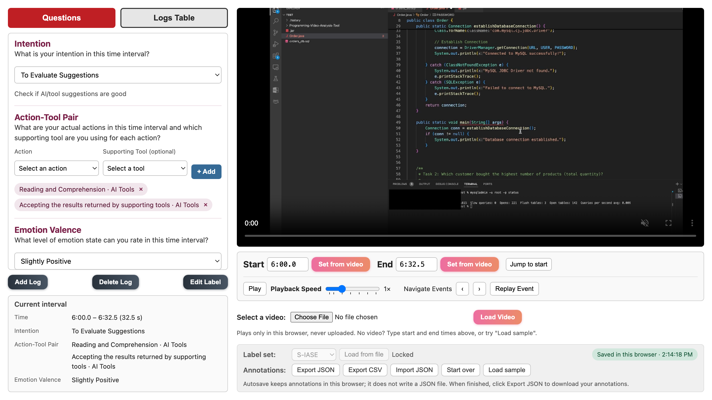
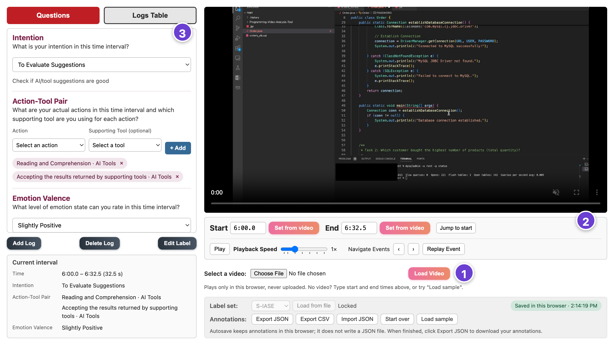
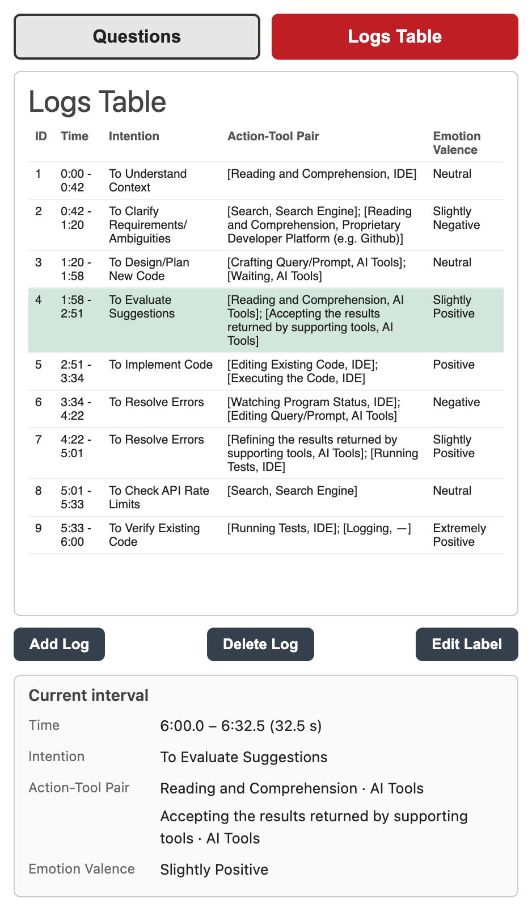

# DevSelfTrace

[](https://github.com/YinanWusoymilk/DevSelfTrace/actions/workflows/ci.yml)

**DevSelfTrace** is a browser-based tool for **retrospective self-annotation of programming behavior**. After a programming session, a developer watches their own screen recording, splits it into time intervals they choose, and labels each interval. With the default label set those labels are their **intention**, their **actions** with the **supporting tool** used for each, and their **emotion**. Researchers get the annotations as structured JSON or CSV for analysis such as sequential pattern mining or qualitative coding.



- **Try it online (nothing to install):** <https://yinanwusoymilk.github.io/DevSelfTrace/app/>
- **Project page:** <https://yinanwusoymilk.github.io/DevSelfTrace/>
- **Demo video:** <https://youtu.be/pXlFTPROoWk>
- **Study that used it (FSE'26):** <https://doi.org/10.1145/3808120>

## Contents

- [Ways to run it](#ways-to-run-it)
- [Annotating a recording](#annotating-a-recording)
- [Label sets](#label-sets)
- [Output](#output)
- [Development](#development)
- [Citation](#citation)

## Ways to run it

DevSelfTrace is a single web page. Pick how participants open it:

| | Install | Annotations are saved | Good for |
|---|---|---|---|
| **Online** | nothing | automatically in the browser; click **Export JSON/CSV** to download a file | trying it out, remote participants |
| **Offline page** | nothing | automatically in the browser; click **Export JSON/CSV** to download a file | no network, or data must stay on the machine |
| **Annotation server** | Python 3 + Bottle | to a JSON file you choose | lab studies |
| **Docker** | Docker | to a JSON file in a mounted folder | lab studies without a Python setup |

In every case **the video stays on the participant's machine**: it is played by the browser and never uploaded.

**Saving:** in the online and offline versions, annotations are autosaved in this browser (they survive a reload), but no file is written. When finished, click **Export JSON** and send that file as the study asks; **Import JSON** continues from it, also in another browser. With the annotation server or Docker, autosave writes the JSON file directly.

### Online

Open <https://yinanwusoymilk.github.io/DevSelfTrace/app/>. No Python or Bottle is needed. **Load sample** shows a made-up session if you want to look around first.

### Offline page

Download or clone this repository and open `app_study/index.html` in a browser. No Python or Bottle is needed.

### Annotation server

The server writes the annotations to a JSON file as the participant works, so nothing has to be exported.

```bash
pip install -r requirements.txt
python app_study/server.py -p data/p01.json --create
```

Then open <http://localhost:8080/>. Options:

| Option | Meaning |
|---|---|
| `-p FILE` | annotations file (required) |
| `--create` | create `FILE` if it does not exist yet (without it, a missing file is an error, so a typo is not silently turned into a new, empty session) |
| `-v VIDEO` | load this recording automatically (otherwise the participant picks it in the page) |
| `-l LABELS` | label set file, e.g. `labels/cups.json` (default: S-IASE, see [Label sets](#label-sets)) |
| `--host`, `--port` | where to listen (default `localhost:8080`) |

### Docker

```bash
docker build -t devselftrace .
docker run --rm -p 8080:8080 -v "$PWD/data:/app/data" devselftrace
```

Then open <http://localhost:8080/>; annotations are saved to `./data/session.json`. Server options go after the image name, for example `... devselftrace -p data/p01.json --create -l labels/cups.json`.

## Annotating a recording



1. **Load the recording** with *Select a video* → *Load Video* (any `.mp4` or `.webm`). No recording at hand? Use **Load sample**.
2. **Mark an interval:** type the start and end times into *Start* and *End* (e.g. `1:02.5`), or play or scrub to where an activity starts or ends and click *Set from video* next to it. The next interval starts where the previous one ended.
3. **Answer the questions** on the left. Each question is one dimension of the label set; for some options a short explanation appears under the menu once chosen (e.g. every intention), and most dimensions also accept a custom label via *Other (type your own)*. For the action–tool question, pick an action and a tool and click *+ Add*; an interval can have several pairs, each shown as a chip that × removes.
4. **Add Log.** The interval appears in the *Logs Table*. Use ‹ › to select an interval, *Replay Event* to watch it again, *Edit Label* to change the answers of the selected interval (only the questions you answer change), and *Delete Log* to remove it.



**Saving.** Changes are saved automatically about a second after each edit; the label in the gray box under the video, at the end of the *Label set* row, shows whether everything is saved. DevSelfTrace protects long sessions:

- If another tab or window saved a newer version in the meantime, the save is refused and you choose to load the other version, keep yours, or export yours, instead of one silently overwriting the other.
- A second tab normally opens read-only.
- On the server, files are replaced in one step (never half-written), and the five previous versions are kept as `FILE.bak1` … `FILE.bak5`.
- If a save fails (server stopped, browser storage full), it is retried and you can export a copy right away.

**Annotations** buttons: *Export JSON* (can be imported again), *Export CSV* (one row per interval), *Import JSON* (continue from an exported file or an older DevSelfTrace file), *Start over* (clears the annotations, offering an export first), *Load sample*.

## Label sets

A **label set** defines the questions: its dimensions, their options and the options' short explanations. It is a JSON file in [`labels/`](labels/):

| File | Contents |
|---|---|
| [`s-iase.json`](labels/s-iase.json) (default) | The S-IASE model from the FSE'26 study: intention (12 options), action–supporting tool pairs (16 actions, 8 tools), emotion valence (7 levels). These are exactly the options the study participants used. |
| [`cups.json`](labels/cups.json) | The 12 CodeRec User Programming States of Mozannar et al. (CHI'24), with their definitions; custom labels are off in this preset. |
| [`template.json`](labels/template.json) | A starting point for your own label set. |

**Choosing a label set:** the *Label set* menu in the page, *Load from file* for your own file, `?labels=cups` in the address (e.g. `.../app/?labels=cups`), or `server.py -l FILE`. The label set is saved with the annotations. Once a session has annotations its label set is locked, so a session never mixes label sets; use *Start over* to switch.

**Writing your own.** Copy `labels/template.json` and edit it. A minimal example:

```json
{
  "name": "Debugging study",
  "description": "What participants suspected and how they checked it.",
  "dimensions": [
    {
      "id": "hypothesis",
      "label": "Hypothesis",
      "prompt": "What did you think was wrong?",
      "type": "single",
      "options": ["Off-by-one", { "value": "Null value", "hint": "Something was undefined" }]
    },
    {
      "id": "checks",
      "label": "Check-Tool Pair",
      "prompt": "How did you check it, and with what?",
      "type": "pairs",
      "fields": [
        { "id": "check", "label": "Check", "options": ["Read code", "Ran tests"] },
        { "id": "tool", "label": "Tool", "optional": true, "options": ["Debugger", "Logs"] }
      ]
    }
  ]
}
```

| Key | Meaning |
|---|---|
| `name` | Shown in the label set menu (required). |
| `description` | Shown when hovering the label set menu. |
| `dimensions` | The questions, in order (required). |
| `id` | Key under which the answer is stored, e.g. `"hypothesis"`. Letters, digits, `-`, `_`; not `id`, `start`, `end` or `duration`. |
| `label` | Short name next to the dropdown (required). |
| `prompt` | The question shown above it (defaults to `label`). |
| `help` | Optional explanation shown under the question. |
| `type` | `"single"`: pick one option. `"pairs"`: add one or more pairs of two `fields`, e.g. an action and the tool used for it. |
| `options` | Strings, or `{ "value": ..., "hint": ... }` to show a short explanation under the menu when that option is chosen. |
| `allowCustom` | `false` turns off custom labels for this dimension (default `true`). |
| `placeholder` | Text shown in the empty dropdown. |
| `optional` | On a pairs field: the field may be left empty (stored as `null`). |

The page checks a label set when it is loaded and lists any problems. To add a label set to the built-in menu, put the file in `labels/` and run `python scripts/build_presets.py`.

## Output

### JSON

Exported files and server files contain the label set, the video (file name and duration) and the intervals. Each interval stores one key per dimension:

```json
{
  "tool": "DevSelfTrace",
  "schemaVersion": 2,
  "labelset": { "name": "S-IASE", "dimensions": ["..."] },
  "video": { "name": "p01_recording.mp4", "duration": 1512.4 },
  "lastId": 3,
  "intervals": [
    {
      "id": 3,
      "start": 153.2,
      "end": 191.45,
      "duration": 38.25,
      "intention": "To Design/Plan New Code",
      "actions": [
        { "action": "Crafting Query/Prompt", "tool": "AI Tools" },
        { "action": "Reading and Comprehension", "tool": null }
      ],
      "emotion": "Slightly Positive"
    }
  ]
}
```

Times are in seconds. Interval IDs are never reused within a session, even after deletions (`lastId` is the highest ID given so far); intervals are listed in video order. Files written by the server also carry a `revision` number, which is how concurrent changes are detected.

### CSV

One row per interval (`id, start, end, duration`, then one column per question). Action–tool pairs are split into `actions.action` and `actions.tool`, with several pairs separated by `; `. Opens directly in R, pandas or Excel.

### Older files

Files saved by the first version of DevSelfTrace are converted automatically when opened or imported (on the server, the original is kept as `p01.v1.json`). To convert many at once:

```bash
python scripts/convert_v1_to_v2.py p01.json p02.json --out-dir converted/
```

## Development

```
app_study/          the page (index.html, static/) and the optional server (server.py)
  static/core.js      annotation logic: label sets, intervals, conversion, export
  static/storage.js   saving: server file or browser storage, autosave, conflicts, tab lock
  static/app.js       the page's controls
labels/             label sets (bundled into static/presets.js)
docs/               project page; docs/app/ is the online copy of app_study/
scripts/            build_presets.py, sync_pages.py, convert_v1_to_v2.py
tests/              js/ (node --test), py/ (unittest), fixtures/
```

Run the tests (CI runs them on every push, together with a Docker build):

```bash
npm test                                   # JavaScript, needs Node.js 20+
pip install -r requirements.txt
python -m unittest discover -s tests/py    # Python
```

After changing:

- **`labels/*.json`:** run `python scripts/build_presets.py`.
- **`app_study/`:** run `python scripts/sync_pages.py` to update the online copy in `docs/app/`.

The tests fail if either step was forgotten.

## Citation

If you use DevSelfTrace, please cite the study it was built for (a tool paper is in preparation):

```bibtex
@inproceedings{wu2026developers,
  title     = {How Do Developers Interact with AI? An Exploratory Study on
               Modeling Developer Programming Behavior},
  author    = {Wu, Yinan and Li, Ze Shi and Stolee, Kathryn Thomasset and Xu, Bowen},
  booktitle = {Proceedings of the ACM International Conference on the
               Foundations of Software Engineering (FSE)},
  year      = {2026},
  doi       = {10.1145/3808120}
}
```

## Acknowledgements

DevSelfTrace started from the video labeling interface of the CUPS study tool by Mozannar et al. ([microsoft/coderec_programming_states](https://github.com/microsoft/coderec_programming_states), MIT License). The CUPS label set in [`labels/cups.json`](labels/cups.json) uses the state names and definitions from that tool.

## License

MIT, see [LICENSE](LICENSE). It also carries Microsoft's copyright notice for the parts that come from the CUPS tool, which is under the same MIT terms.
